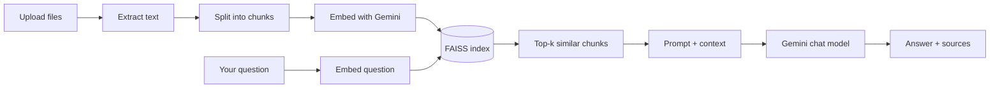

# Docsight

Chat with your own documents. Upload PDFs, Word files, text files or JSON, ask questions in plain language, and get answers that come only from your files, with the exact source shown next to every answer.

Docsight is a Retrieval-Augmented Generation (RAG) app built with Streamlit, LangChain, FAISS and Google Gemini. Your chats are saved on disk, so you can close the browser and pick up where you left off.

<!-- Add a screenshot or GIF here once you have one:

-->

---

## Features

- **Four file types, side by side.** PDF, DOCX, TXT and JSON. Upload as many as you like in one go and ask questions across all of them.
- **Answers with sources.** Every answer comes with the chunks it was built from, labelled by file name and page number (for PDFs).
- **Stays inside your documents.** The prompt tells the model to answer only from the retrieved context. If the answer isn't there, it says so instead of guessing.
- **Saved chat history.** Every upload creates a chat. Messages, sources and the search index are stored locally, so reopening an old chat needs no re-upload and no re-embedding.
- **Bring your own Gemini key.** No key is bundled or stored. Each user pastes their own in the sidebar.
- **Streaming answers.** A small typing animation shows while Gemini works, then the answer streams in.
- **Adjustable retrieval.** Chunk size, chunk overlap and the number of chunks per answer are all configurable from the sidebar.
- **Custom model names.** Google retires models fairly often, so the sidebar has a "Custom..." option where you can type any Gemini model name.
- **Friendly failure handling.** Corrupt files, empty files and scanned PDFs with no text layer are skipped with a clear warning instead of crashing the app. Embedding runs in small batches with retries to cope with free-tier rate limits.

---

## How it works



1. **Extract.** Each file type has its own reader:
   - PDF: text is pulled page by page with `pypdf`, so page numbers survive into the citations.
   - DOCX: paragraphs and table rows are read with `python-docx`.
   - TXT: decoded as UTF-8, with a Latin-1 fallback.
   - JSON: flattened into `path: value` lines (for example `user.address.city: Lahore`), which makes keys and values easy to find with semantic search.
2. **Split.** Text is cut into overlapping chunks with LangChain's `RecursiveCharacterTextSplitter`.
3. **Embed.** Chunks are turned into vectors with Gemini's embedding model and stored in a local FAISS index.
4. **Retrieve.** Your question is embedded the same way and the closest chunks are fetched.
5. **Generate.** The chunks and the question go to a Gemini chat model with a strict "answer only from context" prompt. The answer streams back along with the source chunks.

---

## Tech stack

| Layer | Tool |
|---|---|
| UI | [Streamlit](https://streamlit.io) with custom CSS |
| Orchestration | [LangChain](https://www.langchain.com) |
| LLM and embeddings | [Google Gemini](https://ai.google.dev) via `langchain-google-genai` |
| Vector store | [FAISS](https://github.com/facebookresearch/faiss) (CPU) |
| File parsing | `pypdf`, `python-docx`, built-in `json` |

---

## Getting started

### Prerequisites

- Python 3.10 or newer
- A Gemini API key. You can get a free one at [aistudio.google.com/apikey](https://aistudio.google.com/apikey)

### Installation

```bash
# 1. Clone the repo
git clone https://github.com/your-username/docsight.git
cd docsight

# 2. (Recommended) create a virtual environment
python -m venv venv
source venv/bin/activate        # Windows: venv\Scripts\activate

# 3. Install dependencies
pip install -r requirements.txt

# 4. Run the app
streamlit run app.py
```

The app opens at `http://localhost:8501`.

> **Note:** Streamlit reads `.streamlit/config.toml` (the light theme) only at startup. If the colours look wrong, stop the app with `Ctrl+C` and start it again instead of just refreshing the page.

### First run

1. Paste your Gemini API key into the sidebar.
2. Upload one or more files (PDF, DOCX, TXT, JSON).
3. Wait for indexing to finish. The stat cards at the top show how many files, chunks and characters were read.
4. Ask a question in the chat box at the bottom.

---

## Using the app

### Sidebar

| Section | What it does |
|---|---|
| **Gemini API key** | Your key. Held only in the browser session and never written to disk. |
| **Chat model** | Pick a Gemini model, or choose **Custom...** and type any model name. |
| **Your chats** | Every saved chat as a card. Click to reopen, ✕ to delete, **New chat** to start fresh. |
| **Retrieval settings** | Chunk size, chunk overlap and chunks per answer (k). |

### Tuning retrieval

| Setting | Default | Effect |
|---|---|---|
| Chunk size | 1000 | Larger chunks keep more context together but make matching less precise. |
| Chunk overlap | 150 | Repeats a bit of text between neighbouring chunks so sentences aren't cut off at the edges. |
| Chunks per answer (k) | 4 | How many chunks are sent to the model. Raise it for broad questions, lower it for sharp ones. |

Changing chunk size or overlap re-indexes the current files, so expect a short wait.

### Question tips

- Ask specific questions. "What is the notice period in the contract?" works better than "Tell me about the contract".
- With several files loaded, name the file in your question if you only care about one of them.
- If you get "I couldn't find that in the documents", try rephrasing or raising k.

---

## Project structure

```
docsight/
├── app.py                  # The whole app: UI, file loading, indexing, chat, history
├── requirements.txt        # Python dependencies
├── .streamlit/
│   └── config.toml         # Light theme settings
├── chat_data/              # Created at runtime. Saved chats and indexes (git-ignored)
│   └── <chat-id>/
│       ├── chat.json       # Title, files, stats, messages and sources
│       └── index/          # FAISS index for this chat
├── .gitignore
└── README.md
```

---

## Configuration

Most things are changed from the sidebar, but a few live in the code at the top of `app.py`:

| Constant | Purpose |
|---|---|
| `CHAT_MODELS` | The models shown in the dropdown. Edit this list when Google adds or retires models. |
| `EMBED_MODEL` | The embedding model (`models/gemini-embedding-001` by default). |
| `DATA_DIR` | Where chats are saved (`chat_data/` by default). |
| `TYPE_STYLE` | Badge label and colour for each file type. |

The look of the app (colours, fonts, animations) is all in the `CSS` string in `app.py`. The palette is defined once as CSS variables under `:root`.

---

## Troubleshooting

**`404 NOT_FOUND ... model is no longer available`**
Google has retired that model. Pick another one from the dropdown, or choose **Custom...** and type a current model name from the [Gemini models page](https://ai.google.dev/gemini-api/docs/models).

**`429` or "quota exceeded" errors while indexing**
You've hit the free-tier rate limit. The app already embeds in small batches and retries, but very large files can still take a while. Wait a minute and try again, or use smaller files.

**Text in dropdowns or inputs is hard to read**
Restart Streamlit fully (see the note under Installation) and make sure `.streamlit/config.toml` sits in the folder you launch the app from.

**"Skipped file (no readable text)"**
The file is probably a scanned PDF or image-only document. Docsight reads text layers and doesn't do OCR.

**Old `.doc` files don't upload**
Only `.docx` is supported. Open the file in Word and save it as `.docx` first.

**A saved chat won't open**
Make sure the chat's `index/` folder is still in `chat_data/<chat-id>/` and that you've entered your API key, since reopening a chat needs the embedding model for new questions.

---

## Privacy and security

- Your API key lives only in the browser session. It is never written to disk or logged.
- Uploaded text is sent to Google's Gemini API for embedding and answering. Don't upload anything you aren't allowed to share with Google.
- `chat_data/` contains the content of your documents and your conversations. It is listed in `.gitignore`, so keep it out of your commits.
- Saved indexes are loaded with `allow_dangerous_deserialization=True`, which is how LangChain loads FAISS files from disk. This is fine for indexes the app created itself. Never drop an index file from an untrusted source into `chat_data/`.
- If you deploy this for several users, they would all share one `chat_data/` folder. Add authentication and per-user storage first.

---

## Limitations

- No OCR, so scanned PDFs and images inside documents aren't read.
- Only the text of DOCX files is read, not images, headers or footers.
- Answers are only as good as the retrieved chunks. Very broad questions ("summarise everything") can miss content outside the top-k chunks.
- Chats are stored locally on the machine running the app.

---

## Roadmap ideas

- CSV, Markdown and PPTX support
- OCR for scanned PDFs
- Ask about one specific file only
- Export a chat as Markdown or PDF
- Per-user accounts and storage
- Hybrid search (keyword plus semantic) for better precision

---

## Contributing

Issues and pull requests are welcome. If you're planning something bigger than a small fix, open an issue first so we can talk it through.

1. Fork the repo
2. Create a branch: `git checkout -b feature/my-idea`
3. Commit your changes and push the branch
4. Open a pull request

---

## License

This project is licensed under the MIT License. Add a `LICENSE` file to the repo with the MIT text and your name.

---

## Acknowledgements

Built with [Streamlit](https://streamlit.io), [LangChain](https://www.langchain.com), [FAISS](https://github.com/facebookresearch/faiss) and [Google Gemini](https://ai.google.dev).
